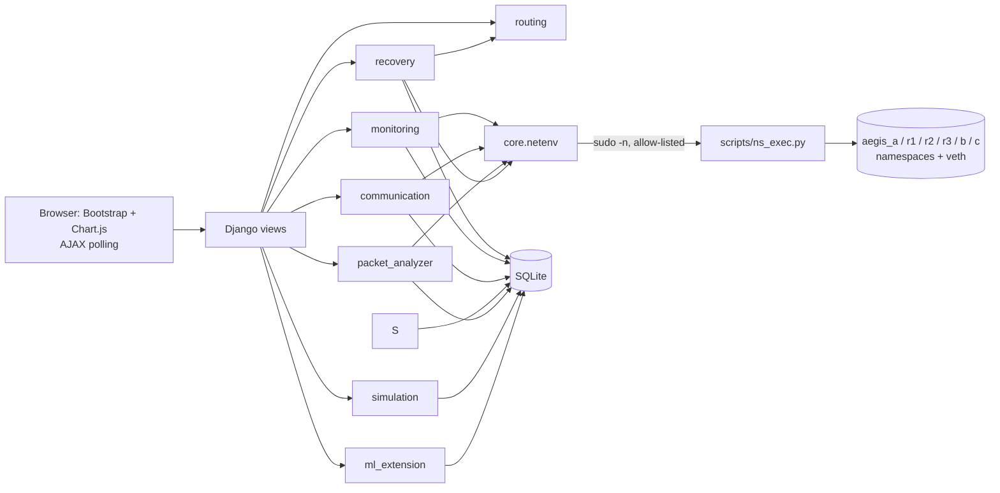
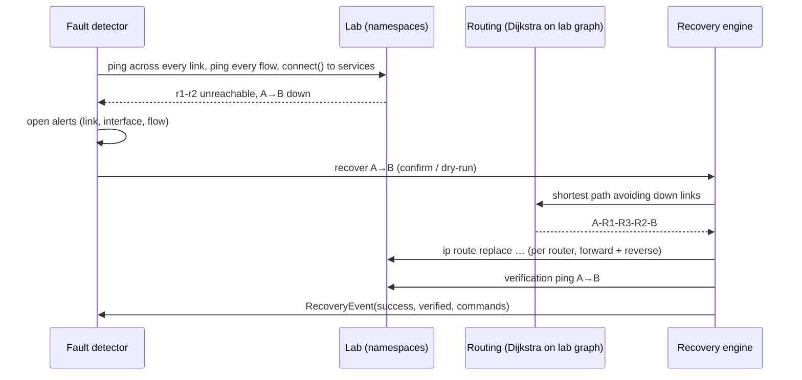

# AegisNet architecture

## Recovery loop

## Database (generated from the models)
| Model | Fields |
|---|---|
| core.Node | name, label, kind, ip_primary, x, y |
| core.Link | name, node_a→Node, node_b→Node, if_a, if_b, ip_a, ip_b, subnet, cost, capacity_mbps, is_primary, admin_down, status, last_latency_ms, last_loss_pct, last_checked |
| core.EventLog | timestamp, source, level, message, details |
| core.ManagedProcess | name, kind, node, command, pid, status, expected_up, started_at, log_path |
| monitoring.MetricSample | timestamp, kind, target, rx/tx bytes & packets, rx/tx rate, utilization_pct, latency_ms, loss_pct, active_connections |
| communication.TransferSession | created, proto, src_node, dst_host, dst_port, kind, filename, bytes_sent, status, ok, connect_ms, total_ms, response, error, steps, mode |
| packet_analyzer.PacketCapture | node, interface, bpf_filter, snaplen, duration, pcap_path, status, packet_count, traffic, mode |
| packet_analyzer.PacketRecord | capture→PacketCapture, index, ts, MACs, IPs, proto, app, ports, length, tcp_flags, ttl, info |
| routing.SandboxTopology | name, data |
| simulation.SimulationRun | scenario, status, executed, return_code, duration_s, trace_path, metrics |
| recovery.ThresholdConfig | key, value, enabled, description |
| recovery.MonitoredFlow | name, src→Node, dst→Node, primary_path, current_path, status, last_latency_ms, last_loss_pct |
| recovery.Alert | kind, severity, target, reason, suggested_action, resolved, resolved_at, mode, link→Link, flow→MonitoredFlow |
| recovery.FailureInjection | kind, target, dry_run, mode, ok, output |
| recovery.RecoveryEvent | alert→Alert, flow→MonitoredFlow, failed_links, old_path, new_path, commands, mode, dry_run, result, verified, verification, trigger |

## Safety layers
1. Views validate input (lab links by name only, lab IPs only, confirmation flags).
2. `core.netenv` never builds shell strings; arguments are lists.
3. `scripts/ns_exec.py` re-validates everything (it does not trust Django) and refuses anything outside the lab.
4. Shell scripts only touch objects named `aegis_*` and support `--dry-run`.
5. If privileges/namespaces are missing the app drops to a labelled simulation instead of failing silently.
